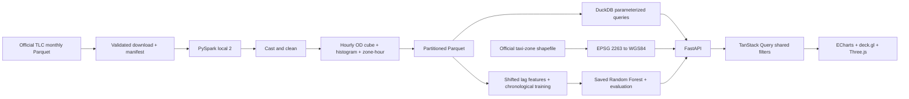

# System architecture

## Contracts

The cube's grain is `(month, pickup hour, pickup zone, drop-off zone)`. Its measures are additive `trips`, `fares`, `distance`, and `duration`. Means divide summed measures by summed trips, avoiding a mean-of-means error. Histograms retain the same time/OD dimensions, so all filters have identical semantics. Browser payloads contain summaries, never raw trip rows.

Filter validation lives in a Pydantic model. SQL values use bound parameters; table names and query shapes come from internal allowlists. Requests open short-lived DuckDB connections with two threads. TanStack Query caches using the complete serialized filter key and aborts obsolete requests.

Routes are lazy-loaded. WebGL scene components are separate from application state. Maps use local GeoJSON, with a minimal style that requires neither commercial tiles nor network access. Models are loaded once per artifact modification time, and their dataset ID must match active processed metadata.

## Geography

Official taxi-zone polygons originate in EPSG:2263. `pyproj` transforms them to EPSG:4326 with longitude first. Shapely simplifies display geometry while preserving topology. Flow endpoints are geometric centroids of original polygons. They are not precise pickup coordinates. Display extrusions are linear in selected trip count; the maximum displayed zone maps to 1,800 display meters. This is explicitly labeled as a display scale.

## Forecasting

Hourly gaps within observed coverage are filled with zero recorded pickups. This presumes complete source coverage; users must supply consecutive complete months. Features are calendar indicators, zone ID, lag 1, lag 24, and shifted 24-hour mean/std. Current target and future observations cannot enter a feature row.

A global chronological 70/15/15 split keeps the same timestamps for all zones. Two depths are compared using validation MAE; the selected Random Forest is evaluated once on test. The baseline is the previous day at the same hour. Evaluation is rolling one-step, not a multi-hour recursive forecast. No uncertainty intervals are fabricated.

## Operational boundaries

This is a local, single-user analytics application. ETL and training are CLI operations, not browser-triggered jobs. Stop serving while replacing the dataset. Models are trusted local artifacts; do not load untrusted joblib files. There is no authentication, production queue, distributed Spark cluster, or live taxi feed. The processing lab displays recorded job metadata, not simulated live execution.
